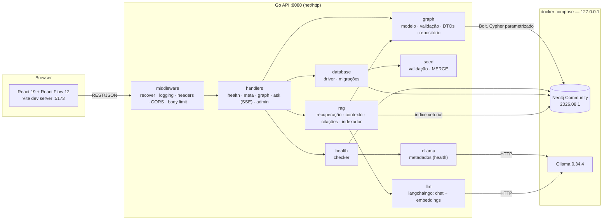
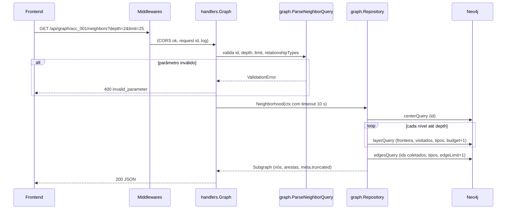
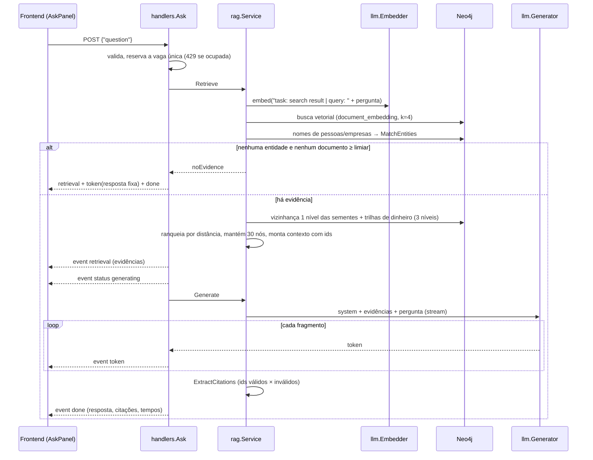

# Arquitetura

## Componentes

| Pacote | Responsabilidade | Depende de |
| --- | --- | --- |
| `cmd/api` | Monta dependências, aplica migrações no start, sobe o servidor, desliga com graça | todos |
| `cmd/seed` | CLI de migração + seed | `config`, `database` |
| `internal/config` | Lê e valida variáveis de ambiente; nunca loga segredos | — |
| `internal/database` | Cria o driver Neo4j, lê e aplica migrações, orquestra migração + seed | `seed` |
| `internal/graph` | Tipos de nó/relacionamento, validação de ids e parâmetros, DTOs, repositório | driver Neo4j |
| `internal/seed` | Lê o JSON do dataset, valida, grava com `MERGE` em uma transação | `graph` |
| `internal/health` | Checa Neo4j (essencial) e Ollama (opcional) em paralelo, com timeout | `ollama` |
| `internal/ollama` | Metadados do Ollama: versão e modelos instalados (health) | — |
| `internal/llm` | Adaptadores langchaingo: `Generator` (chat em streaming) e `Embedder` | `rag` (interfaces), langchaingo |
| `internal/rag` | Pipeline GraphRAG: entidades da pergunta, busca vetorial, expansão, contexto, citações, indexador de embeddings | `graph`, driver Neo4j |
| `internal/http` | Router (`routes.go`), `handlers/` (inclui `ask.go`, SSE), `middleware/` | `graph`, `health`, `rag` |

As dependências só apontam "para dentro": `http` conhece `graph`, mas `graph` não conhece HTTP.
Handlers dependem de interfaces (`graph.Reader`, `handlers.HealthRunner`, `handlers.SeedFunc`),
o que permite testá-los com fakes.

## Fluxo de uma requisição de grafo

## Fluxo de uma pergunta (`POST /api/ask`)

Etapas da recuperação (`rag.Service.Retrieve`):

1. **Sementes**: documentos com score ≥ 0,66 e a até 0,05 do melhor; entidades citadas na
   pergunta por id (`acc_007`) ou nome (nome completo, primeiro ou último nome distintivo,
   sem acentos/maiúsculas).
2. **Expansão**: vizinhança de 1 nível de cada semente; para as entidades citadas e as
   mencionadas pelos documentos, vizinhança de 1 nível e trilha de dinheiro de 3 níveis
   (`OWNS`, `SENT`, `TO_ACCOUNT`). Tudo via `graph.Reader.Neighborhood` (mesmos limites da API).
3. **Ranqueamento**: BFS a partir das sementes; mantém os 30 nós mais próximos e as arestas
   entre eles; até 2 documentos alcançados pelo grafo entram como trecho.
4. **Contexto** (`BuildContext`): linhas curtas sempre com ids — entidades, relações,
   transferências `[txn] [conta origem] (de dono) -> [conta destino] (de dono): valor…`
   e documentos entre `<<< >>>`.
5. **Geração**: prompt de sistema com regras de citação e linguagem neutra; temperatura 0;
   até 450 tokens.
6. **Validação**: ids citados que não estão no contexto são marcados como inválidos.

### Travessia limitada (BFS por camadas)

`Repository.Neighborhood` não usa caminhos de comprimento variável (`[*1..n]`), que enumeram
todos os caminhos e podem explodir em grafos densos. Em vez disso:

1. Busca o nó central; se não existe, `ErrNotFound` → 404.
2. Para cada nível até `depth`, uma consulta retorna os vizinhos **ainda não visitados** da
   fronteira, `DISTINCT`, ordenados por `id`, com `LIMIT budget + 1`. O `+1` detecta corte.
3. Após coletar os nós, uma consulta retorna os relacionamentos **entre** eles (subgrafo
   induzido), limitados a `3 × limit`.

Assim o custo de cada consulta é limitado pelos parâmetros, e `meta.truncated` informa se
algum limite foi atingido.

## Ciclo de vida da API

1. `config.Load` valida o ambiente; erro → processo termina com mensagem clara.
2. `database.NewDriver` cria o driver (conexões são preguiçosas, então não falha se o Neo4j
   estiver fora do ar).
3. Se o Neo4j responde em até 15 s, aplica migrações pendentes; senão registra aviso e segue.
4. Registra rotas; a rota de seed só existe se `ADMIN_SEED_ENABLED=true` e `APP_ENV≠production`.
5. `ListenAndServe` com timeouts de leitura/escrita/idle.
6. SIGINT/SIGTERM → `Shutdown` com 10 s de prazo → `driver.Close`.

A API permanece no ar com o Neo4j indisponível: `/api/health` responde `503` e as rotas de
grafo respondem `503 graph_unavailable`. Quando o Neo4j volta, a API se recupera sem reinício.

## Saúde das dependências

| Dependência | Essencial | Falha → status | HTTP |
| --- | --- | --- | --- |
| Neo4j | sim | `unavailable` | 503 |
| Ollama inacessível | não | `degraded` | 200 |
| Ollama sem os modelos configurados | não | `degraded` | 200 |

O Ollama não é essencial para a exploração do grafo. Sem ele, `POST /api/ask` responde
`503 model_unavailable` e o resto da aplicação segue funcionando.

## Decisões

| Decisão | Motivo | Alternativas descartadas |
| --- | --- | --- |
| `net/http` padrão (Go 1.22+ com padrões `GET /api/graph/{id}`) | Roteamento suficiente, sem dependências | chi, gin, echo |
| Rótulo técnico `:Entity` em todos os nós + unicidade em `id` | Uma restrição garante ids únicos entre tipos e acelera buscas por id sem saber o tipo | Restrição por rótulo + `UNION` nas consultas |
| Ids com prefixo de tipo (`per_001`) | Validáveis por regex, legíveis, tipo derivável do id | UUID (opaco para investigação manual) |
| BFS por camadas em vez de `[*1..n]` | Custo limitado e previsível | Caminhos variáveis + `LIMIT` depois |
| Whitelist de propriedades por tipo nos DTOs | Campos técnicos futuros (embeddings) nunca vazam | Retornar `properties(n)` inteiro |
| Id de aresta determinístico `origem:TIPO:destino` | Frontend deduplica sem conhecer ids internos do Neo4j | `elementId(r)` |
| Seed em JSON validado + consultas fixas por tipo | Rótulos e tipos não vêm do arquivo; valores sempre como parâmetros | Script Cypher livre |
| API sobe mesmo sem Neo4j | Health distingue API viva de dependência fora | Falhar no start |
| langchaingo só na camada de modelos | Portabilidade de provedor sem prender o pipeline a abstrações que não cobrem grafo | Chains `RetrievalQA` (só vetorial); cliente HTTP próprio (sem portabilidade) |
| Índice vetorial nativo do Neo4j | Vetores e grafo no mesmo banco; uma consulta junta similaridade e travessia | Vector store externo (langchaingo não tem store Neo4j) |
| Recuperação híbrida (vetor + nomes/ids + trilhas de dinheiro) | Perguntas citam entidades e padrões; só vetor perde a estrutura | RAG só vetorial |
| Sem evidência → resposta fixa sem LLM | Evita alucinação e responde em < 1 s | Deixar o modelo responder |
| SSE sobre `POST` | Streaming simples, sem WebSocket; cancelamento fecha a conexão | WebSocket; polling |
| Uma pergunta por vez | Geração ocupa a CPU; concorrência só pioraria a latência de todos | Fila |
| Embeddings com hash (modelo + texto) | Reindexação idempotente e automática quando texto ou modelo mudam | Recalcular sempre |
| Ollama via Docker, modelos baixados manualmente | Reprodutível, sem downloads de GB a cada `up` | Pull automático no entrypoint |

## Configuração

Todas as configurações vêm de variáveis de ambiente (lista completa no
[README](../README.md#1-configurar-variáveis-de-ambiente)). `config.Load` recebe uma função
`getenv`, o que permite testar a validação sem alterar o ambiente do processo.

Timeouts fixos no código:

| Onde | Valor |
| --- | --- |
| Consulta ao grafo (por requisição) | 10 s |
| Retry de transação do driver | 3 s |
| Conexão/aquisição de conexão Neo4j | 5 s |
| Cada checagem de saúde | 3 s |
| Pergunta (`/api/ask`), total | 5 min (prazo de escrita estendido no stream) |
| Heartbeat SSE | 10 s |
| Seed via API | 60 s |
| Servidor: header / leitura / escrita / idle | 5 / 10 / 90 / 60 s |
| Cliente HTTP de metadados do Ollama | 30 s |
| Chat/embeddings (langchaingo) | sem timeout global; 3 min até os cabeçalhos; limitado pelo contexto da requisição |
