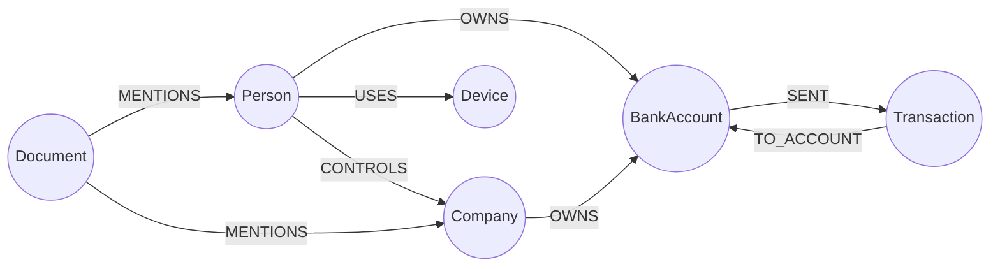

# Modelo de dados

## Schema



Uma transferência é sempre `(:BankAccount)-[:SENT]->(:Transaction)-[:TO_ACCOUNT]->(:BankAccount)`:
a transação é um nó (e não um relacionamento) para poder ter propriedades próprias, ser
mencionada por documentos e receber embeddings no futuro.

`(:Company)-[:OWNS]->(:BankAccount)` foi adicionado ao modelo pedido para representar contas
corporativas.

## Rótulos e propriedades

Todo nó tem **dois rótulos**: `:Entity` (técnico) e um rótulo de domínio.

| Rótulo | Prefixo do id | Propriedade | Tipo Neo4j | Observação |
| --- | --- | --- | --- | --- |
| `Person` | `per_` | `name` | String | |
| `Company` | `cmp_` | `name`, `sector` | String | `sector`: `retail`, `consulting`, `logistics`, `import_export`, `technology` |
| `BankAccount` | `acc_` | `bank`, `status` | String | `status`: `active`, `under_review`, `closed` |
| `Transaction` | `txn_` | `amount` | Float | valor positivo |
| | | `currency` | String | ISO 4217 (`BRL`, `USD`) |
| | | `status` | String | `completed`, `pending`, `reversed`, `failed` |
| | | `timestamp` | DateTime | |
| `Device` | `dev_` | `device_type` | String | `mobile`, `desktop`, `tablet` |
| `Document` | `doc_` | `text`, `source` | String | `source`: `internal_note`, `kyc_record`, `device_alert`, `news_article`, `analyst_report` |
| | | `created_at` | DateTime | |

A fonte de verdade dessa tabela é `graph.NodeSpecs` e `graph.RelSpecs` em
`backend/internal/graph/model.go`. Só as propriedades listadas são expostas pela API.

## Identificadores

Formato `^(per|cmp|acc|txn|dev|doc)_[0-9]{3,9}$`. O prefixo precisa corresponder ao rótulo
(o seed rejeita `cmp_001` rotulado como `Person`). Ids são estáveis: o seed e o frontend os
usam como chave.

## Índices e restrições

Definidos em `neo4j/migrations/001_constraints.cypher`:

| Nome | Tipo | Alvo |
| --- | --- | --- |
| `entity_id_unique` | unicidade | `:Entity(id)` |
| `person_name` | range | `:Person(name)` |
| `company_name` | range | `:Company(name)` |
| `transaction_timestamp` | range | `:Transaction(timestamp)` |
| `document_created_at` | range | `:Document(created_at)` |

## Migrações

- Arquivos `NNN_descricao.cypher` em `neo4j/migrations/`, aplicados em ordem lexical.
- Comandos separados por `;`; linhas iniciadas por `//` são comentários.
- Todo comando deve ser idempotente (`IF NOT EXISTS`).
- Cada arquivo aplicado gera `(:Migration {version, name, applied_at})`; arquivos já
  registrados são pulados. Versões duplicadas abortam a execução.
- Nunca edite uma migração aplicada; crie outra.
- Aplicadas por `go run ./cmd/seed --migrate-only`, pelo seed completo, pela rota admin e no
  start da API (se o Neo4j estiver acessível).

O índice vetorial da etapa 2 tem um modelo em `neo4j/migrations/README.md` e só deve ser
criado com a dimensão real do modelo de embeddings
(ver [Roadmap GraphRAG](graphrag-roadmap.md#4-índice-vetorial)).

## Seed

Arquivo: `data/seed/financial_network.json`.

```json
{
  "version": "2026-10-11.1",
  "description": "...",
  "nodes": [{ "id": "per_001", "label": "Person", "properties": { "name": "Ana Ribeiro" } }],
  "relationships": [{ "type": "OWNS", "from": "per_001", "to": "acc_001" }]
}
```

Validações antes de gravar (`seed.Dataset.Validate`):

- campos JSON desconhecidos são rejeitados;
- rótulo conhecido e prefixo do id compatível; ids únicos;
- apenas propriedades permitidas, todas obrigatórias; `amount` numérico positivo; datas RFC 3339;
- tipo de relacionamento conhecido, extremidades existentes, direção conforme `RelSpecs`, sem duplicatas.

Escrita (`seed.Run`): uma transação de escrita; uma consulta `UNWIND … MERGE (n:Entity {id})
SET …` por rótulo e uma `MERGE (a)-[:TIPO]->(b)` por tipo de relacionamento. Rótulos e tipos
vêm de tabelas fixas no código, nunca do arquivo.

Idempotência: `MERGE` por `id` e por (origem, tipo, destino). Reexecutar não cria nada
(`nodesCreated = 0`). O seed **não remove** dados ausentes do arquivo; para recomeçar use
`docker compose down -v` (apaga os volumes).

## Dataset sintético

Composição: 8 pessoas, 5 empresas, 13 contas, 18 transações, 6 dispositivos, 6 documentos
(56 nós); 13 `OWNS`, 5 `CONTROLS`, 18 `SENT`, 18 `TO_ACCOUNT`, 9 `USES`, 14 `MENTIONS`
(77 relacionamentos). Todos os nomes, bancos e valores são fictícios.

### Pessoas, empresas e contas

| Pessoa | Contas | Controla | Dispositivos |
| --- | --- | --- | --- |
| `per_001` Ana Ribeiro | `acc_001` | `cmp_001` Atlas Comércio, `cmp_002` Borealis Consultoria | `dev_001` |
| `per_002` Bruno Tavares | `acc_002` | | `dev_002` |
| `per_003` Carla Mendes | `acc_004` | | `dev_002` |
| `per_004` Diego Farias | `acc_008`, `acc_011` (encerrada) | `cmp_004` Delta Importadora | `dev_003` |
| `per_005` Elisa Moura | `acc_009` | `cmp_005` Estrela Serviços Digitais | `dev_003`, `dev_004` |
| `per_006` Fábio Lins | `acc_007` (em revisão) | | `dev_003` |
| `per_007` Gustavo Prado | | `cmp_003` Cedro Logística | `dev_005` |
| `per_008` Helena Costa | `acc_013` | | `dev_006` |

Contas corporativas: `cmp_001` → `acc_003`, `cmp_002` → `acc_005`, `cmp_003` → `acc_006`,
`cmp_004` → `acc_010`, `cmp_005` → `acc_012`.

### Padrões incluídos

Os padrões são **sinais para investigação**, não conclusões. Os documentos do dataset
registram explicitamente que nenhuma conclusão foi tomada.

| Padrão | Caminho | Ponto de partida sugerido |
| --- | --- | --- |
| Transferências em cadeia, valores logo abaixo de 10 mil, em menos de 90 min, com retorno | `acc_001 →txn_005→ acc_005 →txn_006→ acc_008 →txn_007→ acc_010 →txn_009 (pendente)→ acc_001` | `acc_001`, profundidade 3, só `SENT`/`TO_ACCOUNT` |
| Dispositivo compartilhado por três pessoas | `per_004`, `per_005`, `per_006` `USES` `dev_003` | `dev_003` |
| Depósitos fracionados de origens distintas seguidos de saída | `acc_011`, `acc_009`, `acc_012` → `acc_007` (3× ~4.900 BRL em 15 min) → `txn_013` 14.000 BRL → `acc_012` | `acc_007` |
| Ligação empresa ↔ pessoa por controle e contas | Diego controla Delta; Elisa controla Estrela e recebe de `acc_007` | `per_004`, `per_005` |

Atividade comum (contraste): salários de Atlas para Bruno e Carla (`txn_001`, `txn_002`),
pagamento de logística (`txn_003`), transferência entre pessoas (`txn_004`), transação
revertida (`txn_014`), cobrança que falhou (`txn_018`, explicada em `doc_006`).

### Documentos

| Id | Origem | Menciona |
| --- | --- | --- |
| `doc_001` | nota interna sobre a cadeia de transferências | Ana, Borealis, Delta |
| `doc_002` | registro cadastral | Diego, Delta |
| `doc_003` | alerta de dispositivo compartilhado | Diego, Fábio, Elisa |
| `doc_004` | matéria sobre parceria comercial | Atlas, Cedro, Gustavo |
| `doc_005` | relatório de analista sobre depósitos fracionados | Fábio, Estrela |
| `doc_006` | nota sobre cobrança contestada (erro operacional) | Helena |

### Alterando o dataset

1. Edite o JSON mantendo ids estáveis e prefixos corretos.
2. Incremente `version`.
3. Rode `cd backend && go test ./internal/seed/` — valida o arquivo do repositório e exige ao
   menos um nó de cada tipo e um relacionamento de cada tipo.
4. Rode o seed. Para remover dados antigos, recrie o volume.
5. Se mudou nós citados nos testes de integração (`per_001`, `acc_001`, …), ajuste-os.
