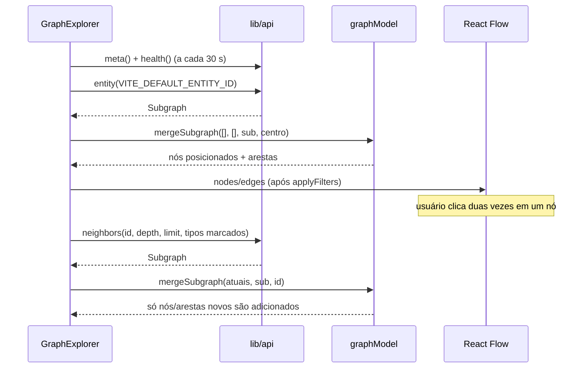

# Frontend

React 19 + Vite 8 + TypeScript strict + `@xyflow/react` 12. Interface em pt-BR.

## Estrutura

```text
frontend/src/
├── main.tsx                     monta <App/> e importa estilos (React Flow + styles.css)
├── App.tsx                      ReactFlowProvider + GraphExplorer
├── styles.css                   tema escuro, layout responsivo, estilos de nós
├── lib/api.ts                   cliente HTTP único, ApiError, timeout de 15 s; ask() lê o stream SSE
├── lib/sse.ts                   parser incremental de Server-Sent Events
├── types/graph.ts               tipos espelhando os DTOs do backend
├── components/
│   ├── Sidebar.tsx              busca, filtros de entidade/relacionamento, opções de expansão
│   ├── DetailsPanel.tsx         propriedades, conexões carregadas, ações
│   ├── HealthBadge.tsx          status de neo4j/ollama no topo
│   └── StateMessage.tsx         estados de carregamento / erro / vazio
├── features/ask/
│   ├── AskPanel.tsx             aba "Perguntar à IA": pergunta, progresso, resposta em streaming, evidências
│   └── citations.ts             separa ids da resposta para virarem botões
└── features/graph/
    ├── GraphExplorer.tsx        orquestração: estado, chamadas à API, renderização das 3 áreas
    ├── GraphCanvas.tsx          <ReactFlow> com controles, minimapa, botão Centralizar, contadores
    ├── EntityNode.tsx           nó customizado por tipo
    ├── RelationshipEdge.tsx     aresta "flutuante" (borda a borda) com rótulo e seta
    ├── graphModel.ts            funções puras: merge, layout radial, filtros
    ├── graphModel.test.ts       testes das funções puras
    └── presentation.ts          cores, rótulos e formatação (moeda, datas, títulos)
```

## Perguntas à IA (`AskPanel`)

O painel direito tem duas abas: **Perguntar à IA** (padrão) e **Detalhes**. Clicar num nó do
grafo abre Detalhes; clicar numa citação mantém a aba de perguntas. As duas ficam montadas,
então trocar de aba não interrompe uma resposta.

| Fase | O que aparece |
| --- | --- |
| Ociosa | caixa de pergunta (Enter envia, Shift+Enter quebra linha) e 3 exemplos |
| `retrieving` | "Buscando evidências no grafo…" + cronômetro |
| `reading` | "O modelo está lendo as evidências…" (fase mais longa em CPU) |
| `generating` | texto chegando com cursor piscando |
| `done` | resposta, modelo, tokens, tok/s e aviso para conferir as evidências |
| `error` | mensagem em pt-BR por código (`busy`, `model_unavailable`, …) |

- Ids na resposta (`[per_004]` ou `per_004`) viram botões (`splitAnswer`). Clicar: se o nó
  está no canvas, seleciona e centraliza; senão, mostra o grafo de evidências centrado nele.
- Ids citados fora das evidências aparecem riscados em vermelho e desabilitados.
- Nós citados recebem a classe `is-cited` (contorno âmbar) no canvas.
- **Ver evidências no grafo** substitui o canvas pelo subgrafo usado na resposta (nós,
  relações e documentos), com layout radial a partir do primeiro id citado.
- **Cancelar** aborta o `fetch`; a API cancela a geração no Ollama.
- Se o Ollama não está `ok` em `/api/health`, o painel avisa antes de perguntar.

## Layout

| Largura | Disposição |
| --- | --- |
| > 1100 px | barra lateral (280 px) · grafo · detalhes (340 px), altura da janela |
| 720–1100 px | barra lateral · grafo; detalhes abaixo |
| < 720 px | grafo (65% da altura) · barra lateral · detalhes, empilhados; minimapa oculto |

## Fluxo de dados



### Estado

- `nodes`/`edges` (React Flow, via `useNodesState`/`useEdgesState`) guardam o grafo carregado e
  as posições. Cada nó carrega `data.entity` (DTO da API), `expanded` e `isRoot`.
- Filtros (`hiddenNodeTypes`, `hiddenRelTypes`) não removem dados: `applyFilters` deriva a
  propriedade `hidden`. O nó raiz nunca é ocultado.
- Tipos de relacionamento desmarcados viram o parâmetro `relationshipTypes` das próximas
  expansões; com todos marcados, o parâmetro é omitido.
- Opções de expansão (`depth`, `limit`) começam com os padrões de `/api/meta` e são limitadas
  aos máximos do servidor.

### Merge sem duplicação (`mergeSubgraph`)

1. Nós já carregados mantêm posição; suas propriedades são atualizadas com a resposta.
2. O nó expandido é marcado `expanded`.
3. Nós novos recebem posição por `layoutAround`.
4. Arestas entram pelo `id` determinístico (`origem:TIPO:destino`) e só se as duas pontas
   estiverem carregadas.

### Layout (`layoutAround`)

- Distância em saltos a partir do nó expandido (`hopDistances`, BFS não direcionada) define o anel.
- Raio = `230 × anel`, aumentado se houver muitos nós no anel (≥ 120 px de arco por nó).
- Se já existe grafo, os nós novos se abrem num arco de 200° voltado para fora do centroide
  dos nós existentes; no primeiro carregamento, círculo completo.
- O enquadramento (`fitView`) espera `useNodesInitialized()` — antes disso os nós não têm
  tamanho medido e o ajuste não funciona. Após expandir, enquadra o nó expandido + os novos.

### Arestas flutuantes

`RelationshipEdge` calcula o ponto em que a linha entre os centros cruza a borda de cada nó
e desenha uma reta com seta. Os `Handle` existem (o React Flow exige) mas ficam invisíveis.
Cor e tracejado por tipo vêm de `REL_STYLE`.

## Estados de interface

| Situação | O que aparece |
| --- | --- |
| Carregando metadados | tela "Conectando à API…" |
| API inacessível | erro em tela cheia com "Tentar novamente" |
| Carregando grafo | spinner no canvas |
| Neo4j fora / entidade inexistente | erro no canvas com mensagem em pt-BR e "Tentar novamente" |
| Sem nós | estado vazio orientando a buscar uma entidade |
| Expansão | aviso "Expandindo…", depois "+N nós, +M relacionamentos", "Nenhuma conexão nova" ou aviso de limite |
| Saúde | pontos verde/amarelo/vermelho por dependência; detalhes no tooltip |

Os códigos de erro da API são traduzidos em `GraphExplorer.tsx` (`ERROR_MESSAGES`).

## Interações

| Ação | Efeito |
| --- | --- |
| Clique no nó | seleciona, centraliza, mostra detalhes |
| Duplo clique no nó | expande com as opções atuais |
| Clique numa conexão no painel | seleciona e centraliza o nó ligado |
| "Explorar a partir daqui" | recomeça o grafo com o nó selecionado como raiz |
| Busca na barra lateral | recomeça o grafo pela entidade escolhida (debounce de 250 ms, mín. 2 caracteres) |
| Arrastar / roda do mouse / controles | reposiciona nós, zoom |
| "Centralizar" | enquadra todos os nós |

Indicadores no nó: ponto na base = ainda não expandido; `!` = conta `under_review`;
borda grossa = raiz.

## Configuração

`vite.config.ts` usa `envDir: '..'`: as variáveis vêm do `.env` da raiz. Só `VITE_*` chegam ao
navegador (`VITE_API_BASE_URL`, `VITE_DEFAULT_ENTITY_ID`). O dev server escuta em
`localhost:5173` com `strictPort`.

## Verificação manual

Fluxo verificado em navegador (Chromium headless via Playwright): carga inicial de `per_001`
(6 nós, 6 arestas); expansão de `acc_001` (+2/+2); reexpansão sem duplicar; duplo clique em
`txn_005` com profundidade 2; filtro de transações; busca por "lins"; largura de 390 px sem
rolagem horizontal; nenhum erro no console; API e Neo4j fora do ar exibindo os erros acima.
