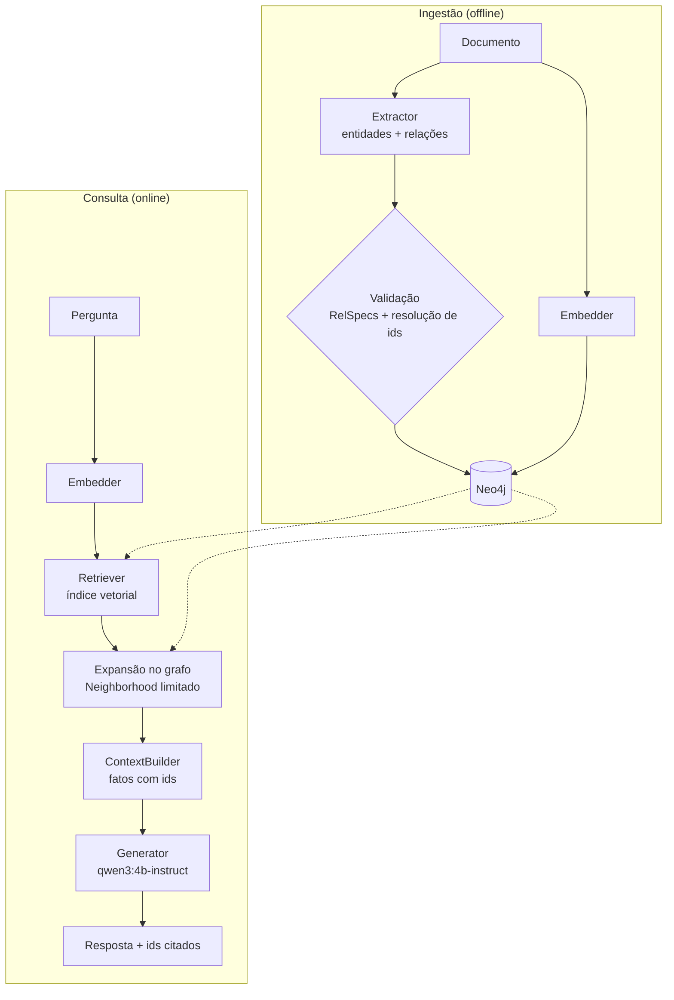

# Roadmap GraphRAG (etapa 2)

Objetivo: responder perguntas em linguagem natural sobre o grafo financeiro com respostas
**fundamentadas em evidências recuperadas** (cada afirmação cita ids de nós/documentos),
usando apenas modelos locais.

## Pipeline alvo



As interfaces já existem em `backend/internal/rag/rag.go`:
`Embedder` (implementada por `ollama.Client`), `Extractor`, `Retriever`, `ContextBuilder`,
`Generator`. A expansão usa `graph.Reader.Neighborhood`, já implementada.

## Etapas

### 1. Ingestão de documentos

- Endpoint/CLI para inserir `Document` (texto + origem + data) com id `doc_…`.
- Reaproveitar a validação de `seed` para formato e tamanho; limitar tamanho do texto.
- Documentos longos: dividir em trechos (`:Chunk`) ligados por `(:Document)-[:HAS_CHUNK]->(:Chunk)`
  se o tamanho passar do contexto útil do modelo de embeddings.

### 2. Extração de entidades e relacionamentos

- `Extractor` com `OLLAMA_CHAT_MODEL` e `format` = JSON schema com `enum` dos tipos permitidos.
- Os testes mostraram que o modelo 4B inventa relações e inverte direções
  ([IA local](ai-models.md#qualidade-observada)). Portanto:
  - descartar tudo que violar `graph.RelSpecs`;
  - resolver nomes para ids existentes (busca exata/normalizada; ambiguidade → não ligar);
  - gravar como proposta com proveniência, ex.: `(:Document)-[:MENTIONS {source:'extraction', model, at}]->()`;
  - nunca criar `Transaction`/`BankAccount` a partir de texto livre.
- Medir precisão/recall contra os `MENTIONS` do seed (ground truth disponível).

### 3. Embeddings

- Escolher o modelo de embeddings com benchmark em pt-BR (candidatos em
  [IA local](ai-models.md#modelo-de-embeddings)); fixar `OLLAMA_EMBED_MODEL` e `OLLAMA_EMBED_DIMENSIONS`.
- Gerar embeddings em lote (`Embed` aceita vários textos) para `Document.text` e para um texto
  descritivo de entidades (ex.: "Pessoa Ana Ribeiro, controla Atlas Comércio e Borealis Consultoria").
- Validar no código que `len(vetor) == OLLAMA_EMBED_DIMENSIONS` antes de gravar.
- Guardar `embedding_model` junto do vetor para detectar vetores desatualizados.
- A propriedade `embedding` já fica fora da API pela whitelist dos DTOs.

### 4. Índice vetorial

Nova migração (`002_…cypher`) com a dimensão real, modelo em `neo4j/migrations/README.md`:

```cypher
CREATE VECTOR INDEX document_embedding IF NOT EXISTS
FOR (d:Document) ON (d.embedding)
OPTIONS { indexConfig: { `vector.dimensions`: 768, `vector.similarity_function`: 'cosine' } };
```

Trocar de modelo exige nova migração (drop + create) e recálculo de todos os vetores.

### 5. Recuperação vetorial

- `Retriever.Search(embedding, k)` com `db.index.vector.queryNodes` (ou sintaxe `SEARCH` da
  versão do Neo4j em uso), `k` limitado no servidor.
- Limiar mínimo de similaridade; abaixo dele, responder que não há evidência suficiente.

### 6. Expansão no grafo

- Para cada documento/entidade recuperada, `Neighborhood` com profundidade 1–2 e tipos
  relevantes à pergunta (ex.: dinheiro → `SENT`, `TO_ACCOUNT`, `OWNS`).
- Limite global de nós no contexto (ex.: 40) para caber no orçamento de tokens.

### 7. Construção de contexto

- Formato compacto, uma linha por fato, sempre com ids:
  `acc_001 SENT txn_005 (9800.00 BRL, 2026-04-02T22:10Z) TO_ACCOUNT acc_005`.
- Orçamento: com processamento de prompt em ~40–50 tok/s na CPU, cada 1.000 tokens de
  contexto custam ~20–25 s. Alvo: ≤ 1.500 tokens.
- Ordenar por relevância (similaridade + distância ao nó recuperado).

### 8. Geração fundamentada

- `Generator` com `qwen3:4b-instruct`, `think: false`, `num_predict` ≤ 400, `stream: true`.
- Prompt de sistema: responder só com as evidências; citar ids entre colchetes; dizer
  explicitamente quando não houver evidência; descrever sinais sem afirmar fraude.
- Pós-processamento: extrair ids citados e verificar que todos estão no contexto; ids
  inexistentes → marcar a resposta como não confiável.

### 9. API e interface

- `POST /api/ask` (só quando 1–8 estiverem reais): pergunta → resposta em streaming (SSE),
  ids citados e subgrafo de evidências.
- Interface: painel de pergunta; destacar no grafo os nós citados; ids clicáveis.
- Retornar `503` próprio se o Ollama estiver indisponível, sem afetar a exploração.

## Critérios de aceite sugeridos

1. Perguntas sobre os padrões do seed ("de onde veio o dinheiro que chegou em `acc_010`?")
   respondidas citando apenas ids presentes no grafo.
2. Pergunta sem evidência ("qual o CPF de Ana?") resulta em "não há evidência".
3. Nenhuma resposta afirma fraude.
4. Tempo de resposta na CPU de referência medido e documentado.
5. Testes de integração do retriever com o Neo4j real.

## Riscos

| Risco | Mitigação |
| --- | --- |
| Latência de ~1 min por resposta em CPU | streaming, contexto curto, cache de embeddings de perguntas frequentes |
| Alucinação de relações na extração | validação por schema, proveniência, revisão humana |
| Embeddings ruins em pt-BR | benchmark antes de fixar o modelo |
| Mudança de modelo de embeddings | `embedding_model` gravado; migração de reindexação |
| Injeção de instruções via texto de documentos | tratar texto recuperado como dado; delimitar no prompt; validar ids citados |
