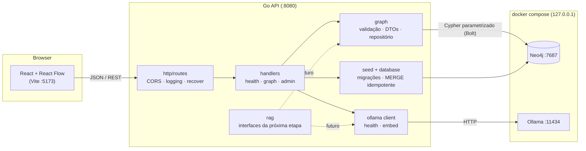

# Financial GraphRAG

Fundação de uma aplicação full-stack para explorar um **Knowledge Graph financeiro sintético**
e preparar uma arquitetura **GraphRAG** (recuperação vetorial + travessia de grafo + LLM local).

- **Backend:** Go 1.27 (`net/http`), driver oficial Neo4j v6
- **Banco de grafos:** Neo4j Community `2026.08.1`
- **IA local:** Ollama `0.34.4` (modelo de chat e de embeddings configurados separadamente)
- **Frontend:** React 19 + Vite 8 + TypeScript strict + React Flow (`@xyflow/react` 12)

> Todos os dados são **fictícios**. Os padrões incluídos no seed (transferências em cadeia,
> dispositivo compartilhado, depósitos fracionados) são sinais para investigação, **não**
> conclusões de fraude.

## Documentação

Documentação técnica detalhada em [`Docs/`](Docs/README.md): arquitetura, API, modelo de dados,
frontend, IA local, roadmap GraphRAG, segurança e guia de desenvolvimento.

## Arquitetura



```text
financial-graphrag/
├── docker-compose.yml         Neo4j + Ollama (portas só em 127.0.0.1, volumes, healthchecks)
├── .env.example               variáveis (sem segredos reais)
├── backend/
│   ├── cmd/api/               servidor HTTP
│   ├── cmd/seed/              CLI: migrações + seed
│   └── internal/
│       ├── config/            leitura e validação de variáveis de ambiente
│       ├── database/          ciclo de vida do driver Neo4j e migrações
│       ├── graph/             modelo, validação de parâmetros, DTOs, repositório Neo4j
│       ├── health/            verificação de dependências
│       ├── http/              routes.go, handlers/, middleware/
│       ├── ollama/            cliente HTTP do Ollama
│       ├── rag/               interfaces do pipeline GraphRAG (próxima etapa)
│       ├── seed/              validação do dataset e escrita idempotente
│       └── integration/       testes de integração contra Neo4j real (build tag)
├── frontend/src/
│   ├── components/            Sidebar, DetailsPanel, HealthBadge, StateMessage
│   ├── features/graph/        GraphExplorer, canvas, nós/arestas, merge e layout
│   ├── lib/api.ts             cliente HTTP centralizado
│   └── types/graph.ts         tipos espelhando os DTOs do backend
├── data/seed/financial_network.json   dataset sintético
└── neo4j/migrations/          scripts Cypher idempotentes
```

## Pré-requisitos

| Ferramenta     | Versão usada no desenvolvimento |
| -------------- | ------------------------------- |
| Docker + Compose v2 | Docker 29.7, Compose 5.5   |
| Go             | 1.27                            |
| Node.js        | 22.12+ (testado com 22.21)      |
| GNU Make, Bash, curl, openssl, ss (iproute2) | padrão em distribuições Linux |

Recursos: o Neo4j usa ~1,5 GB de RAM (heap 1 GB + page cache 512 MB). O modelo de chat
`qwen3:4b-instruct` requer ~2,5 GB de disco e ~3,2 GB de RAM; `nomic-embed-text` ~270 MB.

## Início rápido

```bash
make dev
```

Um único comando, idempotente, que:

1. cria o `.env` a partir do `.env.example` com senha do Neo4j e token admin aleatórios (se ainda não existir);
2. verifica ferramentas, versões e se as portas 8080/5173 estão livres;
3. sobe Neo4j e Ollama e espera os healthchecks;
4. baixa os modelos do Ollama **que ainda não existem** (só na primeira vez);
5. instala as dependências do frontend se necessário;
6. compila a API, aplica migrações e o seed (sem duplicar dados);
7. inicia API e frontend juntos, com logs prefixados `[api]`/`[web]`, e mostra as URLs.

Abra **http://localhost:5173**. `Ctrl+C` encerra API e frontend; os contêineres continuam
rodando (`make stop` para pará-los). Se uma das aplicações cair, a outra também é encerrada.

Outros comandos (`make help` lista todos):

| Comando | O que faz |
| --- | --- |
| `make dev` | sobe tudo (acima) |
| `make setup` | prepara tudo sem iniciar API/frontend |
| `make stop` | para API/frontend e os contêineres (dados preservados) |
| `make stop-apps` | encerra API/frontend que ficaram rodando em outro terminal |
| `make down` | remove os contêineres (volumes com dados e modelos preservados) |
| `make status` | contêineres, portas e `/api/health` |
| `make seed` / `make migrate` | aplica seed + migrações / só migrações |
| `make reset-db` | **apaga** os dados do Neo4j e refaz o seed (pede confirmação) |
| `make models` | baixa os modelos configurados que faltam |
| `make test` / `make test-integration` | testes unitários / integração com Neo4j real |
| `make lint` / `make build` | gofmt + vet + typecheck / binários e bundle de produção |
| `make logs` | logs do Neo4j e Ollama |

Opções: `SKIP_MODELS=1 make dev` (não baixa modelos), `SKIP_SEED=1 make dev` (só migrações),
`FORCE=1 make reset-db` (sem confirmação). Os scripts ficam em [`scripts/`](scripts/).

## Execução manual (passo a passo)

As seções 1–4 descrevem o que `make dev` faz, para quem quiser entender ou depurar cada etapa.

## 1. Configurar variáveis de ambiente

```bash
cp .env.example .env
# Gere valores locais para a senha do Neo4j e o token administrativo:
sed -i "s/^NEO4J_PASSWORD=.*/NEO4J_PASSWORD=$(openssl rand -hex 16)/" .env
sed -i "s/^ADMIN_TOKEN=.*/ADMIN_TOKEN=$(openssl rand -hex 24)/" .env
```

O mesmo `.env` é usado pelo Docker Compose, pelo backend (carregado no shell) e pelo
frontend (o Vite lê apenas as variáveis `VITE_*`, via `envDir: '..'`).

| Variável | Uso |
| --- | --- |
| `APP_ENV` | `development`, `test` ou `production`. Em `production` o endpoint de seed nunca é registrado. |
| `HTTP_ADDR` | Endereço da API (padrão `127.0.0.1:8080`). |
| `CORS_ALLOWED_ORIGIN` | Única origem aceita pelo CORS (padrão `http://localhost:5173`). |
| `NEO4J_URI`, `NEO4J_USER`, `NEO4J_PASSWORD`, `NEO4J_DATABASE` | Conexão Bolt. A senha também inicializa o contêiner. |
| `OLLAMA_URL`, `OLLAMA_CHAT_MODEL`, `OLLAMA_EMBED_MODEL` | Ollama e modelos (chat e embeddings separados). |
| `OLLAMA_EMBED_DIMENSIONS` | Dimensão do modelo de embeddings (`nomic-embed-text` = 768). Só será usada ao criar o índice vetorial. |
| `MIGRATIONS_DIR`, `SEED_FILE` | Caminhos relativos a `backend/`. |
| `ADMIN_SEED_ENABLED`, `ADMIN_TOKEN` | Habilitam `POST /api/admin/seed` (token ≥ 16 caracteres). |
| `VITE_API_BASE_URL`, `VITE_DEFAULT_ENTITY_ID` | URL da API e entidade inicial do frontend. |

> A senha do Neo4j é definida **na primeira inicialização** do volume. Para trocá-la depois,
> altere-a no Neo4j ou remova o volume (`docker compose down -v`, apaga os dados).

## 2. Iniciar Neo4j e Ollama

```bash
docker compose up -d --wait
docker compose ps
```

| Serviço | Porta (somente 127.0.0.1) | Uso |
| --- | --- | --- |
| Neo4j Browser | `7474` | http://localhost:7474 |
| Neo4j Bolt | `7687` | driver Go |
| Ollama | `11434` | API HTTP |

### Baixar os modelos do Ollama (uma vez)

Os modelos **não** são baixados automaticamente na inicialização dos contêineres.
Baixe-os manualmente; eles ficam persistidos no volume `ollama_models`:

```bash
docker compose exec ollama ollama pull nomic-embed-text
docker compose exec ollama ollama pull qwen3:4b-instruct
docker compose exec ollama ollama list
```

#### Modelo de chat: `qwen3:4b-instruct`

Escolhido para rodar só em CPU num notebook Ryzen 5 (Zen 2, 6 núcleos, AVX2; a iGPU Radeon
não é usada pelo Ollama). É o Qwen3-4B-Instruct-2507, Q4_K_M. Medido nesta máquina
(Ollama 0.34.4, `num_ctx` 4096, temperatura 0):

| Tarefa | Prompt | Geração | Tempo total | RAM |
| --- | --- | --- | --- | --- |
| Extração de entidades com JSON schema | 116 tokens | ~7 tok/s | ~45 s | 3,2 GB |
| Resposta fundamentada (PT-BR, cita ids) | 457 tokens | ~7 tok/s | ~45 s | 3,2 GB |

Primeira chamada após carregar o modelo: +6 a 12 s. Para uso futuro:

- **Não use a tag `qwen3:4b`**: ela aponta para a variante *Thinking-2507*, que sempre
  raciocina (o `think: false` é ignorado), gera centenas de tokens antes da resposta e
  passou de 8 minutos sem limite de tokens neste notebook.
- Sempre defina `num_predict` nas chamadas de geração para limitar tempo de resposta.
- Em 4B, a extração de relacionamentos inventa tipos e inverte direções: os resultados
  precisam ser validados contra o schema (`graph.RelSpecs`) antes de gravar no grafo.

Enquanto os modelos não estiverem disponíveis, `/api/health` reporta o Ollama como
`degraded` (a exploração do grafo funciona normalmente). O Ollama roda em CPU por padrão;
para GPU NVIDIA, adicione `deploy.resources.reservations.devices` ao serviço.

## 3. Executar migrações e seed

```bash
cd backend
set -a; source ../.env; set +a
go run ./cmd/seed                 # migrações + dataset
go run ./cmd/seed --migrate-only  # apenas migrações
```

Saída da primeira execução e de uma execução repetida (idempotente):

```json
{ "version": "2026-10-11.1", "nodes": 56, "relationships": 77, "nodesCreated": 56, "relationshipsCreated": 77, "propertiesSet": 196 }
{ "version": "2026-10-11.1", "nodes": 56, "relationships": 77, "nodesCreated": 0,  "relationshipsCreated": 0,  "propertiesSet": 140 }
```

Alternativa via API (somente desenvolvimento local, veja [Segurança](#segurança)):

```bash
curl -X POST -H "X-Admin-Token: $ADMIN_TOKEN" http://localhost:8080/api/admin/seed
```

A API também aplica migrações pendentes ao iniciar, quando o Neo4j está acessível.

## 4. Iniciar backend e frontend

```bash
# Terminal 1 — API
cd backend
set -a; source ../.env; set +a
go run ./cmd/api            # ou: go build -o bin/api ./cmd/api && ./bin/api

# Terminal 2 — frontend
cd frontend
npm ci
npm run dev                 # http://localhost:5173
```

Abra **http://localhost:5173** (use `localhost`, não `127.0.0.1`: a origem precisa coincidir
com `CORS_ALLOWED_ORIGIN`).

### Usando a interface

- O grafo começa por `VITE_DEFAULT_ENTITY_ID` (padrão `per_001`) e suas conexões diretas.
- **Busca** (barra lateral): por nome ou id; selecionar um resultado recomeça a exploração.
- **Clique** em um nó: propriedades e conexões carregadas no painel de detalhes.
- **Duplo clique** ou **Expandir conexões**: chama `/neighbors` com profundidade, limite e
  tipos de relacionamento marcados; nós e arestas já carregados não são duplicados.
- **Filtros**: ocultam tipos de entidade/relacionamento; tipos de relacionamento desmarcados
  também são excluídos das próximas expansões.
- **Centralizar**, zoom, minimapa e arrastar nós estão disponíveis no canvas.
- Nós com ponto inferior ainda não foram expandidos; `!` marca conta com status `under_review`.

Sugestões de exploração: `acc_001` com profundidade 3 e apenas `SENT`/`TO_ACCOUNT`
(cadeia de transferências e retorno circular); `dev_003` (dispositivo compartilhado);
`acc_007` (depósitos fracionados seguidos de saída).

## Endpoints

Todas as respostas são JSON. Erros seguem `{"error": {"code", "message", "field?"}}`, sem
detalhes internos (credenciais, stack traces ou mensagens do driver ficam só nos logs).

| Método | Rota | Descrição |
| --- | --- | --- |
| GET | `/api/health` | Estado da API e das dependências. `200` com `ok`/`degraded`; `503` se o Neo4j (essencial) estiver indisponível. Ollama é opcional nesta etapa. |
| GET | `/api/meta` | Tipos de nó e relacionamento, propriedades expostas e limites do servidor. |
| GET | `/api/entities?q=&type=&limit=` | Busca por id ou nome (`limit` ≤ 50). |
| GET | `/api/graph/{id}?limit=` | Entidade e conexões diretas (profundidade 1). |
| GET | `/api/graph/{id}/neighbors?depth=&limit=&relationshipTypes=` | Vizinhança com travessia limitada. |
| POST | `/api/admin/seed` | Migrações + seed. Apenas com `ADMIN_SEED_ENABLED=true`, `APP_ENV≠production`, header `X-Admin-Token` e cliente loopback. |

Limites de `/neighbors` (impostos no servidor; valores fora da faixa retornam `400`):

| Parâmetro | Padrão | Faixa | Observação |
| --- | --- | --- | --- |
| `depth` | 1 | 1–3 | |
| `limit` | 25 | 1–100 | nós além da entidade central |
| — | — | `3 × limit` | máximo de relacionamentos |
| `relationshipTypes` | todos | `OWNS, CONTROLS, SENT, TO_ACCOUNT, USES, MENTIONS` | separados por vírgula ou repetidos |

Exemplos:

```bash
curl -s http://localhost:8080/api/health
curl -s http://localhost:8080/api/graph/per_001
curl -s 'http://localhost:8080/api/graph/acc_001/neighbors?depth=3&limit=10&relationshipTypes=SENT,TO_ACCOUNT'
curl -s 'http://localhost:8080/api/entities?q=lins'
```

Resposta de `/api/graph/per_001` (resumida):

```json
{
  "center": { "id": "per_001", "type": "Person", "properties": { "name": "Ana Ribeiro" } },
  "nodes": [
    { "id": "acc_001", "type": "BankAccount", "properties": { "bank": "Banco Fictício Alfa", "status": "active" } },
    { "id": "per_001", "type": "Person", "properties": { "name": "Ana Ribeiro" } }
  ],
  "edges": [
    { "id": "per_001:OWNS:acc_001", "type": "OWNS", "source": "per_001", "target": "acc_001" }
  ],
  "meta": { "depth": 1, "nodeLimit": 25, "edgeLimit": 75, "relationshipTypes": [], "nodeCount": 6, "edgeCount": 6, "truncated": false }
}
```

A direção de cada relacionamento é `source → target`. `meta.truncated` indica que algum
limite cortou o resultado.

## Modelo de dados

Todo nó tem o rótulo técnico `:Entity` (com restrição de unicidade em `id`) e um rótulo de domínio.
Os ids seguem `<prefixo>_<3 a 9 dígitos>` e são validados em todas as rotas.

| Rótulo | Prefixo | Propriedades |
| --- | --- | --- |
| `Person` | `per_` | `name` |
| `Company` | `cmp_` | `name`, `sector` |
| `BankAccount` | `acc_` | `bank`, `status` (`active`, `under_review`, `closed`) |
| `Transaction` | `txn_` | `amount` (float), `currency`, `status`, `timestamp` (datetime) |
| `Device` | `dev_` | `device_type` |
| `Document` | `doc_` | `text`, `source`, `created_at` (datetime) |

```cypher
(:Person)-[:OWNS]->(:BankAccount)
(:Company)-[:OWNS]->(:BankAccount)      // adição: contas corporativas
(:Person)-[:CONTROLS]->(:Company)
(:BankAccount)-[:SENT]->(:Transaction)
(:Transaction)-[:TO_ACCOUNT]->(:BankAccount)
(:Person)-[:USES]->(:Device)
(:Document)-[:MENTIONS]->(:Person)
(:Document)-[:MENTIONS]->(:Company)
```

Somente as propriedades listadas acima são retornadas pela API; campos técnicos futuros
(por exemplo, `embedding`) não vazam para o cliente.

O dataset (`data/seed/financial_network.json`) tem 8 pessoas, 5 empresas, 13 contas,
18 transações, 6 dispositivos e 6 documentos. O arquivo é validado antes da escrita
(campos desconhecidos, prefixos, propriedades, direção dos relacionamentos, duplicidades)
e gravado em uma única transação com `MERGE` por `id`.

## Testes

Atalhos: `make test`, `make test-integration`, `make lint`, `make build`. Equivalentes manuais:

```bash
# Backend — testes unitários (validação, DTOs, handlers, config, seed, health, ollama)
cd backend && go test ./...

# Backend — integração contra o Neo4j do docker compose (seed idempotente, travessias, limites)
cd backend && set -a && source ../.env && set +a && go test -tags integration -count=1 ./internal/integration/

# Frontend — merge/deduplicação, layout e filtros
cd frontend && npm test

# Frontend — typecheck + build de produção
cd frontend && npm run build
```

Os testes de integração usam o banco `neo4j` de desenvolvimento (o Community Edition tem um
único banco de usuário); como o seed é idempotente, isso não altera os dados.

## Segurança

- Consultas Cypher sempre parametrizadas. Tipos de relacionamento e rótulos usados em
  consultas vêm de tabelas fixas no código e são validados contra uma lista fechada.
- Profundidade, quantidade de nós e de relacionamentos limitadas no servidor; timeout de 10 s
  por consulta e retry do driver limitado a 3 s.
- Sem credenciais no código; a configuração falha ao iniciar se `NEO4J_PASSWORD` estiver ausente.
- CORS para uma única origem; cabeçalhos `nosniff`, `X-Frame-Options`, CSP restritiva; corpo ≤ 1 MB.
- `POST /api/admin/seed`: desabilitado por padrão, nunca registrado com `APP_ENV=production`,
  exige token (comparação em tempo constante) e cliente loopback.
- Portas do Docker publicadas apenas em `127.0.0.1`.
- As rotas de leitura **não têm autenticação** nesta etapa: não exponha a API fora da máquina local.

## Limitações conhecidas

- A expansão é uma busca em largura por camadas; com `limit` atingido, a escolha dos nós
  de uma camada é por ordem de `id`, não por relevância.
- O seed só cria/atualiza; relacionamentos removidos do arquivo não são apagados do banco
  (use `docker compose down -v` para recomeçar do zero).
- `amount` é armazenado como float; um sistema real usaria valores inteiros em centavos ou decimal.
- Se o Neo4j estiver fora do ar quando a API inicia, as migrações são aplicadas no próximo
  seed (a API continua respondendo e reporta `503` em `/api/health`).
- O layout dos nós expandidos é radial e simples; nós podem ser reposicionados manualmente.
- Não há endpoint de chat: ele só será criado quando a recuperação real existir.

## Próximos passos (GraphRAG)

O pacote [`backend/internal/rag`](backend/internal/rag/rag.go) define as interfaces do pipeline:

1. **Ingestão de documentos** → nós `Document`.
2. **Extração de entidades/relacionamentos** (`Extractor`) com o modelo de chat.
3. **Embeddings** (`Embedder`, já implementado por `ollama.Client.Embed` via `POST /api/embed`).
4. **Índice vetorial** no Neo4j: nova migração com a dimensão real do modelo
   (modelo em [`neo4j/migrations/README.md`](neo4j/migrations/README.md)); validar contra `OLLAMA_EMBED_DIMENSIONS`.
5. **Recuperação vetorial** (`Retriever`) de documentos e entidades.
6. **Expansão no grafo** a partir dos resultados (`graph.Reader.Neighborhood`, já implementado).
7. **Construção de contexto** (`ContextBuilder`) com ids das evidências.
8. **Geração de respostas** (`Generator`) citando as evidências recuperadas.
